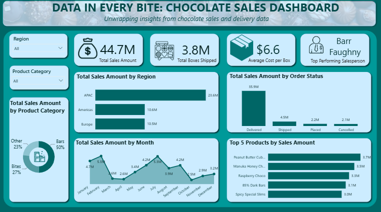

# Data in Every Bite: Chocolate Sales Dashboard
### Unwrapping insights from chocolate sales and delivery data

#### About the Project

**Data in Every Bite: Chocolate Sales Dashboard** is an interactive Microsoft Power BI dashboard designed to explore chocolate sales performance, product demand, regional sales distribution, order fulfilment and salesperson performance.

The dashboard brings together key sales indicators and visualisations to provide an overview of chocolate sales across different regions, product categories, months, order statuses and individual products.

It combines multiple perspectives to help identify patterns in revenue, compare product performance and understand how sales and deliveries are distributed across the business.

The project is an analytical and data visualisation exercise intended to demonstrate how business data can be transformed into meaningful, interactive insights. The underlying data for the dashboard is a simulated practice dataset and as such, should be interpreted in the context of the project rather than as independently verified business results.

#### Project Objectives

The dashboard was created to explore five main questions:

1. Which regions contribute the most to total chocolate sales?
2. Which product categories and individual products generate the highest sales?
3. How does sales performance change from month to month?
4. What proportion of orders falls into different delivery and order-status categories?
5. How do overall sales, boxes shipped and salesperson performance compare?

#### Dashboard Preview

| Chocolate Sales Dashboard |
|---|
|  |

#### Dashboard Components

##### 1. Sales Performance Overview

The dashboard opens with four key performance indicators (KPIs):

- **Total Sales Amount:** 44.7M
- **Total Boxes Shipped:** 3.8M
- **Average Cost per Box:** $6.6
- **Top Performing Salesperson:** Barr Faughny

These indicators provide an overview of sales activity, shipment volume, average cost per box and the leading salesperson displayed in the report.

##### 2. Regional Sales Analysis

The regional sales chart compares total sales across three regions:

- APAC
- Americas
- Europe

The displayed figures show APAC leading with 23.6M in sales, followed by the Americas at 10.6M and Europe at 10.5M.

This visualisation allows for comparison of regional contributions and exploration of differences in sales performance across the markets represented in the dataset.

##### 3. Product Category Analysis

The product category donut chart examines how total sales are distributed across three categories:

- Bars — 50%
- Bites — 27%
- Other — 23%

The visual indicates that Bars account for the largest share of sales by product category, followed by Bites and Other.

This comparison helps us understand the relative contribution of each product category to the overall sales mix.

##### 4. Monthly Sales Trends

The monthly sales line chart tracks sales performance from January through December.

It allows for examination of fluctuations throughout the year, identification of months with relatively high or low sales and exploration of potential seasonal patterns in chocolate sales.

##### 5. Order Status Analysis

The order status chart compares total sales amounts across four order statuses:

- Delivered — 35.9M
- Shipped — 4.5M
- Placed — 2.2M
- Cancelled — 2.1M

Delivered orders account for the largest displayed sales amount, followed by Shipped, Placed and Cancelled orders.

This view helps us examine how sales amounts are distributed across the different order statuses represented in the report.

##### 6. Top Five Products by Sales Amount

The dashboard ranks five products according to their displayed sales amounts:

- Peanut Butter Cub — 3.7M
- Manuka Honey — 3.5M
- Raspberry Choco — 3.3M
- 85% Dark Bars — 3.1M
- Spicy Special Slims — 3.0M

This chart highlights the leading products by sales amount and allows for comparison of their relative performance.

#### Key Insights

The dashboard provides several initial observations that can guide further analysis.

##### a. Regional Sales Distribution

APAC has the highest displayed regional sales amount at 23.6M, exceeding both the Americas and Europe. This makes regional performance an important area factor in this project.

##### b. Product Category Contribution

Bars account for 50% of the displayed product category distribution, making them the largest category in the visualisation. Bites contribute 27%, while Other accounts for 23%.

##### c. Order Status Distribution

Delivered orders have the largest displayed sales amount at 35.9M. The remaining amounts are distributed across Shipped, Placed and Cancelled orders.

##### d. Monthly Performance

Monthly sales fluctuate throughout the year, suggesting that sales performance varies over time. Further investigation could help us determine whether these changes reflect seasonal demand or other factors.

##### e. Leading Products

Peanut Butter Cub leads the displayed Top 5 Products chart at 3.7M, followed by Manuka Honey at 3.5M. This gives us a quick comparison of the highest-ranked products by sales amount.

These observations are descriptive findings from the displayed dashboard. They do not, on their own, establish the causes of sales differences or explain the underlying business conditions.

#### Tools Used

- **Microsoft Power BI** — Dashboard development, Data visualisation and Interactive reporting.
- **Power Query** - Data cleaning and Data transformation

#### Visualisations

The dashboard uses a combination of:

- KPI cards
- Horizontal bar charts
- Donut chart
- Line chart
- Interactive slicers

#### Interactive Features

The dashboard is designed to support interactive exploration rather than simply present static figures.

##### i. Filter by Region

Use the Region slicer to examine sales performance for the selected region.

##### ii. Filter by Product Category

Use the Product Category slicer to investigate sales across the available product categories.

##### iii. Compare Sales Performance

Explore the regional and product charts to compare sales contributions and identify differences between the displayed categories.

##### iv. Explore Monthly Trends

Use the monthly sales chart to examine how sales amounts change throughout the year.

##### v. Examine Order Status

Compare the sales amounts associated with Delivered, Shipped, Placed and Cancelled orders.

##### vi. Identify Leading Products

Use the Top 5 Products chart to compare the displayed sales amounts of the leading products.

#### Live Dashboard

The dashboard has been published through Microsoft Power BI Service. Tap on the link below to explore the Live Dashboard.

**Published dashboard:** <iframe title="Chocolate-sales_dashboard" width="600" height="373.5" src="https://app.powerbi.com/view?r=eyJrIjoiYzFkZTQxNjgtOGI4ZS00ZDJiLWE0ZDYtZDVkM2QyODU4ODc3IiwidCI6IjEwNGQ4MDQ4LWZkMGMtNDNkNS1hNjMwLWZjNjI5ZTVkYWI1OSJ9" frameborder="0" allowFullScreen="true"></iframe>

For the best viewing experience, open the dashboard on a desktop or laptop and use Power BI's full-screen option where available.

#### Why This Dashboard?

Sales datasets can contain multiple dimensions that are difficult to interpret when presented only as tables or individual figures.

**Data in Every Bite** brings key sales indicators together in a single interactive report, allowing users to move from an overall view of performance to more specific questions about:
Regional Performance, Product Categories, Monthly Trends, Order Status, Top Products, amongst others.

This structure helps us explore sales performance from several perspectives and identify areas that may warrant further analysis.

The dashboard also demonstrates the value of business intelligence tools in transforming sales data into insights that support business decisions.

#### Author:
#### Naa Akweley Marley
LinkedIn: [Naa Akweley Marley](https://www.linkedin.com/in/naa-akweley-marley)